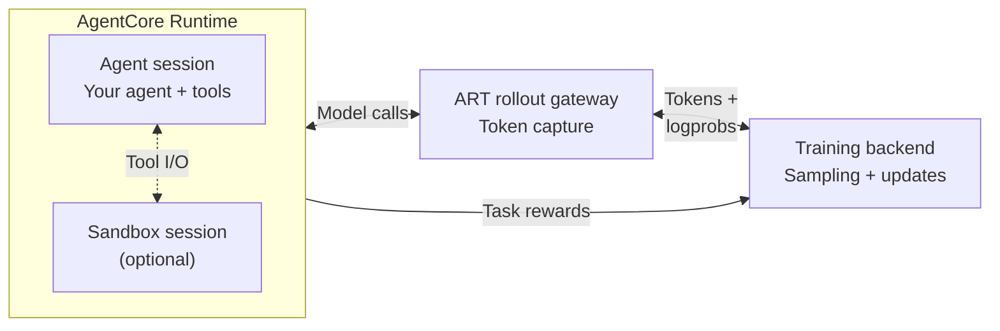

# 🚀 AgentCore RL Toolkit (ART)

**Scalable, Composable Reinforcement Learning for Real-World Agents.**

[](https://github.com/awslabs/agentcore-rl-toolkit/actions/workflows/unit-tests.yml)
[](https://pypi.org/project/agentcore-rl-toolkit/)
[](https://pypi.org/project/agentcore-rl-toolkit/)
[](LICENSE)

[Website](https://awslabs.github.io/agentcore-rl-toolkit/) · [Documentation](https://awslabs.github.io/agentcore-rl-toolkit/guides/overview/) · [Getting Started](#getting-started) · [Blogs](https://awslabs.github.io/agentcore-rl-toolkit/blog/) · [Examples](#example-agents)

**AgentCore RL Toolkit (ART)** helps developers improve custom agents with
reinforcement learning on **AWS Bedrock AgentCore Runtime**. It brings together
scalable, sandboxed rollouts, token-level trajectory capture, training integrations,
and examples spanning coding, office automation, and customer service.

Bring your agent framework, tools, and environments. Define your reward function
and choose either a self-hosted or a managed training backend while keeping most
of your production code intact.

## 🎯 Agents We've Trained

Our experiments include Strands and OpenHands agents working with real
repositories, office applications, and stateful customer-service environments.

<table>
  <thead>
    <tr>
      <th>Agent and task</th>
      <th>Model</th>
      <th>Task success</th>
      <th>Learn more</th>
    </tr>
  </thead>
  <tbody>
    <tr>
      <td rowspan="2"><strong>Java code migration</strong><br/>Strands · MigrationBench</td>
      <td><a href="https://huggingface.co/Qwen/Qwen3.8-27B">Qwen3.8-27B</a></td>
      <td><strong>52% → 93%</strong></td>
      <td rowspan="2"><a href="https://rllm-project.com/post.html?post=agentcore_migrationbench.md">rLLM collaboration</a><br/><a href="examples/strands_migration_agent/">Agent code</a></td>
    </tr>
    <tr>
      <td><a href="https://huggingface.co/Qwen/Qwen3-Coder-30B-A3B-Instruct">Qwen3-Coder-30B-A3B</a></td>
      <td><strong>43% → 76%</strong></td>
    </tr>
    <tr>
      <td><strong>Office automation</strong><br/>Strands · OfficeBench</td>
      <td><a href="https://huggingface.co/Qwen/Qwen3-30B-A3B-Instruct-2507">Qwen3-30B-A3B</a></td>
      <td><strong>24% → 41%</strong></td>
      <td><a href="https://awslabs.github.io/agentcore-rl-toolkit/blog/training-multi-step-agents-rl/">Results</a> · <a href="examples/strands_officebench_agent/">Agent code</a></td>
    </tr>
    <tr>
      <td><strong>Software engineering</strong><br/>OpenHands · SWE-Gym</td>
      <td><a href="https://huggingface.co/Qwen/Qwen3-Coder-30B-A3B-Instruct">Qwen3-Coder-30B-A3B</a></td>
      <td><strong>56% → 64%</strong></td>
      <td><a href="https://awslabs.github.io/agentcore-rl-toolkit/examples/openhands-swegym-agent/">Results</a> · <a href="examples/openhands_swe_agent/">Agent code</a></td>
    </tr>
    <tr>
      <td><strong>Customer service</strong><br/>Strands · τ²-Bench Telecom</td>
      <td><a href="https://huggingface.co/Qwen/Qwen3-30B-A3B-Thinking-2507">Qwen3-30B-A3B-Thinking</a></td>
      <td><strong>38% → 96%</strong> (SFT + RL)</td>
      <td><a href="https://awslabs.github.io/agentcore-rl-toolkit/blog/data-synthesis-v0/">Data synthesis and results</a></td>
    </tr>
    <tr>
      <td><strong>Automotive assistant</strong><br/>Strands · CAR-bench</td>
      <td><a href="https://huggingface.co/Qwen/Qwen3-30B-A3B-Thinking-2507">Qwen3-30B-A3B-Thinking</a></td>
      <td><strong>52% → 83%</strong> (SFT + RL)</td>
      <td><a href="https://awslabs.github.io/agentcore-rl-toolkit/blog/data-synthesis-v0/">BMW collaboration</a></td>
    </tr>
  </tbody>
</table>

## 🧩 What ART Provides

- **Train your own agent.** Reuse your framework, tools, and application logic.
  Examples include Strands, OpenHands, and mini-swe-agent; agents use standard
  OpenAI- or Anthropic-compatible model clients.
- **Scale complex rollouts.** Run long-running agents and their environments on
  [Bedrock AgentCore Runtime](https://docs.aws.amazon.com/bedrock-agentcore/latest/devguide/agents-tools-runtime.html),
  with isolated sessions and on-demand scaling. Builds, tests, and tool execution
  run separately from the GPU training infrastructure.
- **Capture the data RL needs.** The rollout gateway records the exact sampled
  token IDs, logprobs, and loss masks across model turns, including branching
  conversations, without custom model wrappers in your agent.
- **Choose your training backend.** Train with verl, slime, Tinker, or SkyRL.
  Agent execution stays separate from model training.
- **Evaluate and verify.** Collect rollout results with concurrency control,
  timeouts, and session cleanup. Use the Sandbox SDK to execute commands and
  verifiers in task-specific container environments on AgentCore.

### How It Works



Tools can run within the agent session or execute commands in a separate sandbox
session for task isolation.

ART's training integrations combine captured trajectories with task rewards so
the backend can update the model. Your agent keeps its application-level model
interface throughout the loop. See the
[architecture overview](https://awslabs.github.io/agentcore-rl-toolkit/guides/overview/)
for the runtime, gateway, and result-delivery details.

## 🔬 Research & Collaborations

We share the training methods and systems work behind these agents, including
joint experiments with the [rLLM](https://rllm-project.com/) team and collaboration
with **BMW** on CAR-bench.

- **[Training a Frontier Java Code Migration Agent with AWS AgentCore Runtime](https://rllm-project.com/post.html?post=agentcore_migrationbench.md)** — with rLLM: long-horizon RL on MigrationBench, from agent deployment to training and evaluation.
- **[Continual Learning via Real-Time RL for Agents](https://rllm-project.com/post.html?post=realtime_rl.md)** — with rLLM: learning from one rollout per task in a simulated real-time setting, improving MigrationBench success from **43% to 59.2%**.
- **[Growing verifiable training tasks from the environment alone](https://awslabs.github.io/agentcore-rl-toolkit/blog/data-synthesis-v0/)** — synthesize training tasks from tools, environment state, and policy documents, with experiments across τ²-Bench and CAR-bench.
- **[Stable Updates, Fewer Sequences](https://awslabs.github.io/agentcore-rl-toolkit/blog/variable-rows-linear-mode/)** — stable optimizer-step batching and token-history preservation; linear mode reduced training sequences by **62.76%** and actor-update time by **18.24%**.
- **[Async RL Performance Optimization](https://awslabs.github.io/agentcore-rl-toolkit/blog/async-rl-performance-optimization/)** — asynchronous training on SWE-Gym achieved approximately **22% higher reward improvement per GPU-hour**.

<a id="getting-started"></a>

## ⚡ Getting Started

The core SDK supports Python 3.11+. Training environments such as Megatron and
the SkyRL service require Python 3.12; follow their setup guides.

Install the core SDK:

```bash
pip install 'agentcore-rl-toolkit[core]'
```

Or use `uv add 'agentcore-rl-toolkit[core]'`. The core SDK includes agent apps and
rollout clients. See the
[installation guide](https://awslabs.github.io/agentcore-rl-toolkit/guides/installation/)
for component-specific dependencies and the deployment CLI.

1. **Start with an agent.** Try the [math agent](examples/strands_math_agent/README.md)
   for a small end-to-end example, or choose a task from [Example Agents](#example-agents).
2. **Choose a [training backend](#training-backends).** Follow its guide for the
   required agent entrypoint, dependencies, AWS deployment, and networking setup.
3. **Define success and train.** Supply task inputs and a reward function, evaluate
   your baseline, then launch the backend's training recipe.

Already have an agent? The
[`AgentCoreRuntimeApp` example](examples/strands_math_agent/rl_app.py)
shows how to keep `@app.entrypoint` while running rollouts and returning task
rewards. Follow your [training backend's guide](#training-backends) for its
supported agent setup and deployment steps.

<a id="training-backends"></a>

## 🔌 Training Backends

ART integrates with the following training backends through its rollout gateway
for token-level trajectory capture.

| Integration | Training setup | Get started |
|---|---|---|
| **verl** | Self-hosted training with verl | [Setup guide](src/agentcore_rl_toolkit/backends/verl/README.md) |
| **slime** | Self-hosted training with slime | [Setup guide](src/agentcore_rl_toolkit/backends/slime/examples/math_agent/SETUP.md) |
| **SkyRL** | Self-hosted training through its Tinker-compatible API | [Training guide](src/agentcore_rl_toolkit/backends/tinker_api/README.md) · [Deployment example](src/agentcore_rl_toolkit/backends/tinker_api/skyrl/README.md) |
| **Tinker** | Managed training through the official Tinker API | [Training guide](src/agentcore_rl_toolkit/backends/tinker_api/README.md) |

SkyRL and Tinker share the toolkit's Tinker-compatible API integration.

### rLLM

**rLLM** natively integrates with AWS Bedrock AgentCore Runtime. Follow its
[AgentCore integration guide](https://docs.rllm-project.com/agent-runtimes/agentcore)
for installation, configuration, and training.

<a id="example-agents"></a>

## 🛠️ Example Agents

| Task | Framework | Example |
|---|---|---|
| Math reasoning with a calculator · GSM8K | Strands | [Start here](examples/strands_math_agent/README.md) |
| Java repository migration · MigrationBench | Strands | [Guide](examples/strands_migration_agent/README.md) |
| Office automation · OfficeBench | Strands | [Guide](examples/strands_officebench_agent/README.md) |
| Personal assistant · AppWorld | Strands | [Guide](examples/strands_appworld_agent/README.md) |
| Customer service · τ²-Bench | Strands | [Guide](examples/strands_taubench_agent/README.md) |
| Software engineering · SWE-Gym | OpenHands | [Guide](examples/openhands_swe_agent/README.md) |
| Terminal tasks · Harbor / TMax | mini-swe-agent | [Guide](examples/tmax_agent/README.md) |

**Terminal agents with separate sandboxes.** The
[terminal agent example](examples/tmax_agent/README.md) uses the Sandbox SDK to
run mini-swe-agent and its task environment in separate AgentCore sessions.
Verifier tests are withheld until the agent finishes, keeping tests and grading
feedback out of the model conversation.

## Contributing

Contributions to agent examples, training integrations, and the core toolkit are
welcome. See [CONTRIBUTING.md](CONTRIBUTING.md) for development setup and contribution
guidelines, and the [design document process](designs/README.md) for significant
features or architectural changes.

## Security

See [security issue notifications](CONTRIBUTING.md#security-issue-notifications).

## License

This project is licensed under the [Apache-2.0 License](LICENSE).
