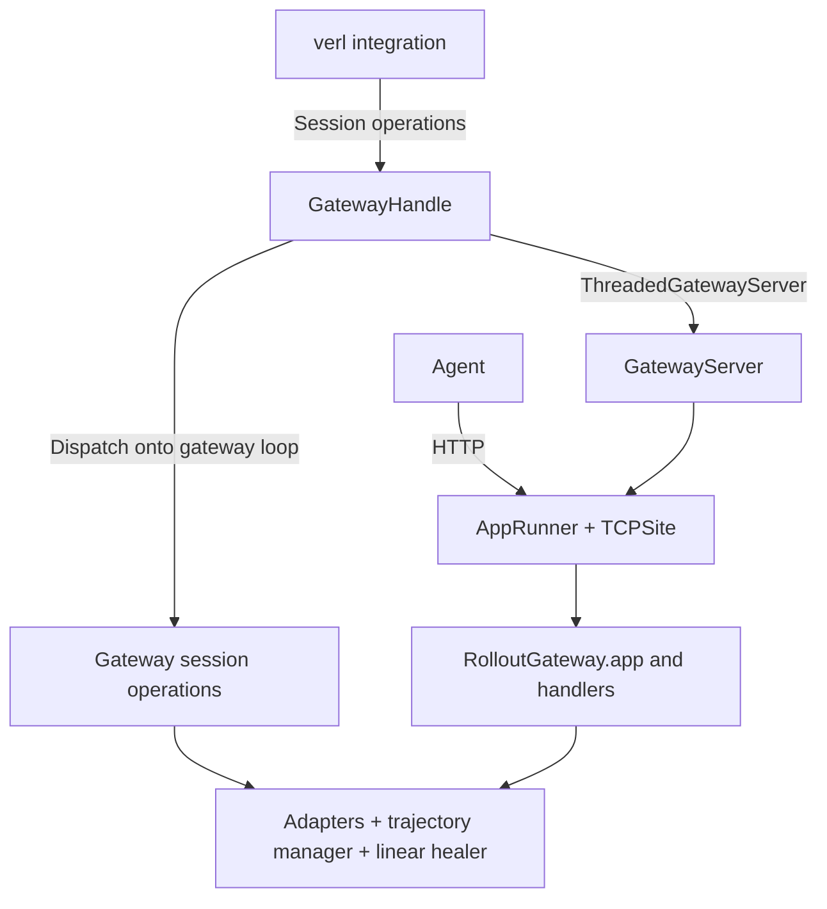

# Rollout gateway: serving and integration boundaries

| Field | Value |
| --- | --- |
| Status | Accepted |
| Implementation | In progress |
| Date | 2026-10-24 |

## Overview

Agents send model requests to the rollout gateway over HTTP. Training
integrations create capture sessions and collect token-level trajectories from
those requests. The gateway combines protocol handling, rendering, sampling, and
capture; its server manages HTTP resources, and its integration handle exposes
session operations and results.

In the verl deployment, each `AgentLoopWorker` process hosts a gateway on a
background thread.

## Motivation

Rendering and tokenization can become CPU bottlenecks as rollout concurrency
grows. Gateway capacity should be able to scale with that work, while rollout
orchestration scales with agent concurrency. An explicit boundary around gateway
operations and state prepares the design for that separation.

Orchestration schedules agents and consumes their results; the gateway handles
model requests and builds trajectories. Separating those responsibilities also
lets training integrations reuse capture and HTTP-serving components with
different sampling engines.

A capture session receives work from both HTTP handlers and the rollout
orchestrator. Giving its mutable state one execution loop makes access and
cleanup easier to reason about. The handle provides that execution boundary
while letting the orchestrator await results from its own loop.

## Architecture

### Components

| Component | Responsibility |
| --- | --- |
| `RolloutGateway` and protocol adapters | Assemble rendering, sampling, and capture; implement session operations and retain trajectory state |
| `GatewayServer` | Manage the aiohttp runner, HTTP listener, advertised address, and HTTP cleanup on the loop where it starts |
| `ThreadedGatewayServer` | Run `GatewayServer` on a background thread and provide cross-loop calls |
| verl `GatewayHandle` | Group the gateway, server, and sampling backend; expose session operations, captured results, and the agent-facing address |
| Training integration | Configure the gateway, provide the sampling client, schedule rollouts, and convert records into training data |

`GatewayHandle` lives in
[`backends/verl/gateway_host.py`](../src/agentcore_rl_toolkit/backends/verl/gateway_host.py).
It is the concrete interface used by the standard verl agent loop. The shared
serving implementation lives in
[`rollout_gateway/server.py`](../src/agentcore_rl_toolkit/rollout_gateway/server.py).

### Placement and request flow

Each verl `AgentLoopWorker` process lazily creates one gateway, shared by its
rollout tasks. Gateway serving has its own thread and event loop within that
process. The worker's rollout loop schedules agents and awaits session operations
through the handle.

`ThreadedGatewayServer` runs the HTTP server on the gateway thread. An agent's
HTTP model requests go directly to the gateway listener. The handle submits
session operations to the same serving loop and returns their results to the
rollout caller.

### Capture interface

The handle exposes `create_session`, `finish_session`, `drop_session`, and session
turn-count reads. `RolloutGateway` and its OpenAI/Anthropic protocol adapters
implement these operations and hold the session state. An agent sends the
capture-session ID in its API-key/Bearer field, associating its model requests
with the session created by the integration.

The gateway supports `tree` and `linear` history modes; see the
[linear-history design](gateway_linear.md) for prefix healing.

`handle.finish_session()` drains in-flight requests and returns a `GatewayResult`
containing records, the turn count, and backend metadata. Finish consumes the
session's captured records; finishing again returns an empty records list.

### Resource lifetime

Session cleanup belongs to the gateway and is exposed through the handle.
The integration owns the handle's lifetime and its HTTP listener and serving
thread. In the verl deployment, the serving thread lives within the
`AgentLoopWorker` process. The sampling client and inference service are owned
by verl.

## Design rationale

### Shared HTTP serving

`GatewayServer` manages HTTP resources around an assembled gateway application.
The protocol adapters and trajectory managers own model handling
and capture state. This keeps serving reusable across integrations and avoids
coupling the HTTP listener to training sample formats or engine-specific
sampling clients.

The async server runs on the loop where it is started. `ThreadedGatewayServer`
composes it with a dedicated thread and exposes synchronous startup and shutdown.
This keeps thread placement separate from the HTTP lifecycle.

### Separate serving-loop scheduling

Dedicated serving and rollout loops have separate asyncio task scheduling.
On a shared loop, synchronous parsing or tokenization can delay agent-result
polling, and synchronous rollout work can delay model-request handling.
The serving thread separates these cooperative-scheduling dependencies.

A thread shares process memory, the Python GIL, and process failures with
the rollout worker. It does not provide the CPU scaling or failure isolation of
independent gateway processes. A shared-loop deployment remains possible where
that scheduling tradeoff is appropriate.

### Sampling backend boundary

The gateway requests token sampling through the `SamplingBackend` interface.
The verl integration supplies `VerlSamplingBackend` to wrap `LLMServerClient`
and its Ray calls, keeping verl-specific dependencies outside the common gateway.

## Longer-term direction

The long-term goal is to run gateway workers in their own processes and size
their pool according to gateway load. The handle's session operations and
returned results provide the interface to carry across that process boundary.

- **Independent scaling:** gateway placement and worker count could be configured
  separately from rollout workers. One gateway could serve sessions from several
  rollout workers. The existing one-per-`AgentLoopWorker` placement remains useful
  when their resource needs scale together.
- **Session ownership:** trajectory state lives in a gateway worker's memory.
  Model requests and lifecycle operations for a session must reach the same
  assigned worker; additional workers can accept new sessions.
- **Dependency ownership:** the integration would construct and configure the
  sampling client in the gateway process. The common capture layer continues to
  use `SamplingBackend` without depending on verl or Ray.

Process deployment would require worker lifecycle management and a transport for
session operations and serialized results, with defined cancellation and
worker-failure behavior.

### An API gateway in front of rollout gateways

The agent-facing address comes from the gateway handle. A worker-pool
implementation could return a session handle carrying the appropriate address,
so session assignment and advertised-address selection would be handled together.

A frontend could provide a stable endpoint, authentication, and routing to
private gateway workers. It would need session affinity and support for the
model APIs' request sizes, streaming behavior, and timeouts. Capture identity
currently travels in the API-key/Bearer field, so frontend authentication would
need to preserve or separately forward that identity.

Network access to gateway listeners would also need to be restricted to the
frontend and authorized components. An API gateway provides an ingress boundary;
it does not itself remove existing direct access to machines or the cluster.
These deployment decisions fit the session-operation boundary without requiring
changes to rendering or trajectory capture.
