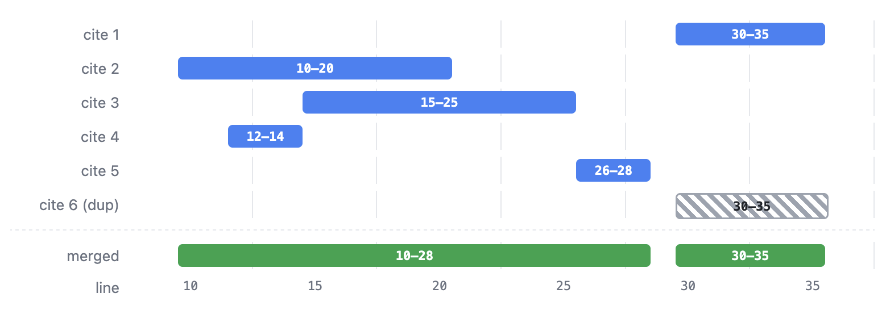
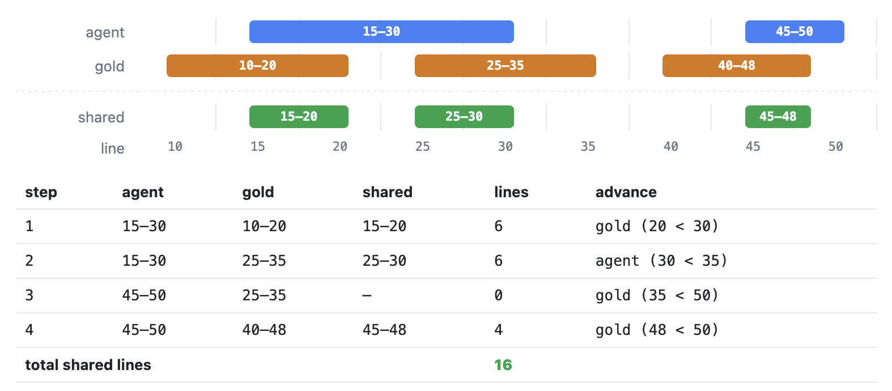
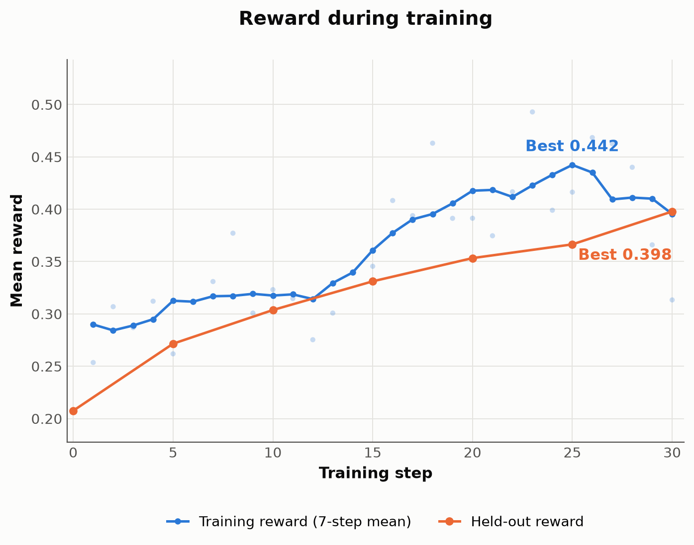
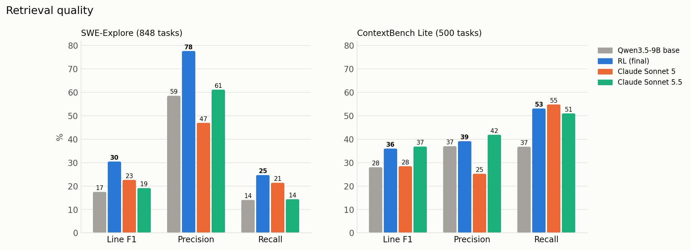
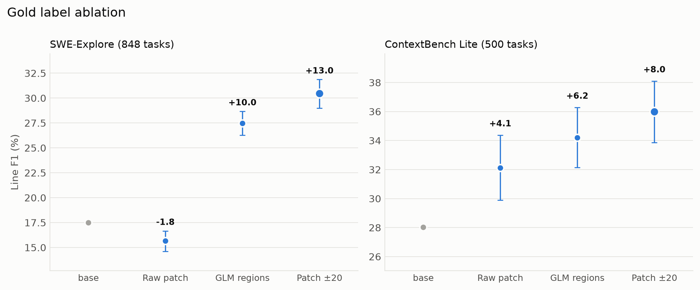
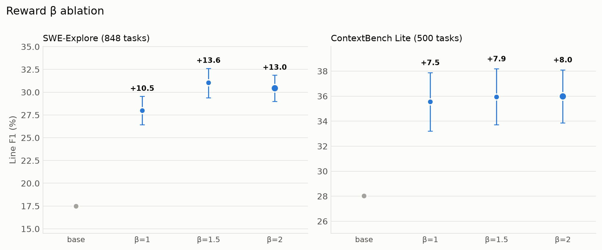
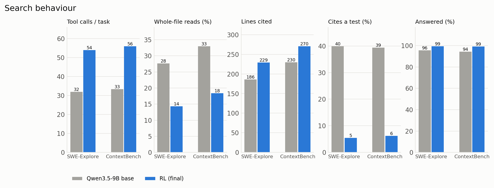
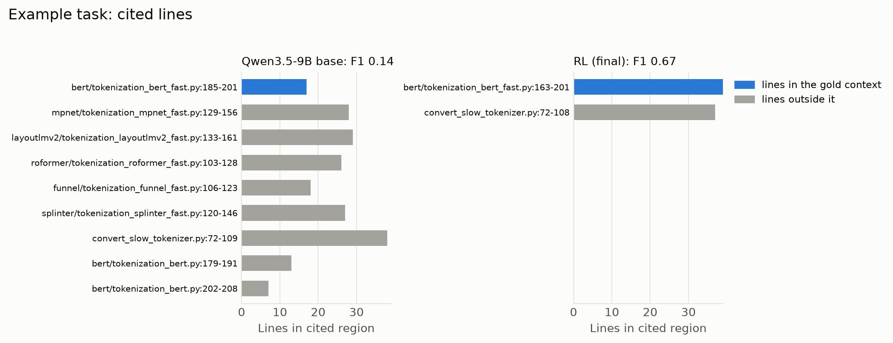
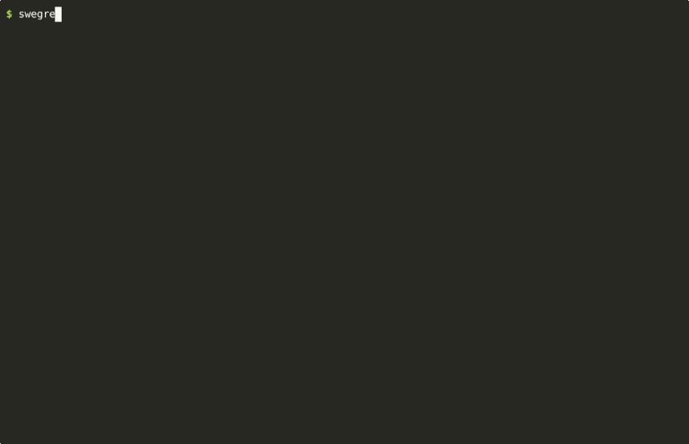

_By [Alexander Newton](https://github.com/xandernewton) · November 10, 2026_

:::note[TL;DR]
We trained Qwen3.5-9B with RL to be a SWE-Grep agent, a small fast agent that only uses grep, glob and read to find the code needed to solve coding queries. We used the [AgentCore RL Toolkit](https://github.com/awslabs/agentcore-rl-toolkit) to run agent rollouts on [Amazon Bedrock AgentCore](https://aws.amazon.com/bedrock/agentcore/) and used [SkyRL's Tinker API server](https://docs.skyrl.ai/docs/tinker/overview) as the model trainer. 

After 30 training steps line F1 rose from 17.5 to 30.5 on [SWE-Explore](https://arxiv.org/abs/2606.07297) and from 28.0 to 36.0 on [ContextBench Lite](https://arxiv.org/abs/2602.05892). The finetuned 9B model beats Claude Sonnet 5 on both benchmarks and Claude Sonnet 5.5 on SWE-Explore and ties Sonnet 5.5 on ContextBench.

The agent training and benchmark code is in [`examples/strands_swegrep_agent`](https://github.com/awslabs/agentcore-rl-toolkit/tree/main/examples/strands_swegrep_agent).
:::

## What is a SWE-Grep Agent?

A SWE-Grep agent only has access to the Grep, Glob and Read tools. Its task is to return the most relevant files and the code regions within them for a user's query. For example, if the query is "Centre the div on the homepage", the agent searches the code repo and returns the relevant files and line spans. Valid answers could be homepage.html or homepage.css which another coding agent would then examine and edit to complete the task. The aim is a small fast agent that specialises in context retrieval with the performance of a large frontier LLM. This work takes inspiration from Cognition's [SWE-grep agent](https://cognition.com/blog/swe-grep).

## Building the agent

The agent is built with the [Strands Python SDK](https://github.com/strands-agents/harness-sdk) which controls the agent loop and tool execution. The agent has the tools:

- grep takes a `pattern` (a regex used to search file contents) and an optional `path` that restricts the search to a subtree
- glob takes a single `pattern` that matches file paths
- read takes a `path` and an optional `start_line` and `end_line` and returns the lines with line numbers

A few adjustments to Strands agents are needed for them to work reliably during rollouts:

- Use the OpenAIModel provider so the agent can talk to a local LLM engine such as vLLM or SGLang.
- Add a max-turn hook that forces the model to submit an answer on the final turn. A final-answer hook can also force an answer when the agent gets near its context limit.
- Use `NullConversationManager()` to prevent any compaction of the message history as the full history has to be preserved for training.
- Set the callback handler to `None` otherwise Strands prints all agent output to stdout.

```python
client = AsyncOpenAI(
    base_url=config["base_url"],
    api_key=config["api_key"],
    timeout=httpx.Timeout(300, connect=120),
    max_retries=0,
)
agent = Agent(
    model=CustomOpenAIModel(client=client, model_id=config["model_id"]),
    tools=build_repo_tools(repo_root),
    system_prompt=build_system_prompt(payload["repo"], top_level_listing(repo_root)),
    hooks=[TurnCapHook()],
    retry_strategy=RetryTransientErrors(max_attempts=4, initial_delay=0.5, max_delay=4),
    conversation_manager=NullConversationManager(),
    callback_handler=None,
)
```

A short system prompt gives the agent an overview of the task, how many turns it has, the filesystem path of the code repo and an optional top-level listing of the repo. When training models of around 9B or smaller it is recommended to thoroughly test them in the harness first to find edge cases. For example in the SWE-Grep harness, smaller models would:

- Generate computationally expensive grep regexes that hang a rollout and max out the CPU
- Call tools with wrong names or wrong arguments
- Fail to submit any files in the final answer due to incorrect answer format, context limit reached or rollout errors

Some of these failures only show up once training starts and may only occur in a small percentage of rollouts. Track failed runs and store their message histories to help find failure modes and use remote backends to run rollouts to prevent one rollout interfering with others. Once the agent was ready we deployed it to Amazon Bedrock AgentCore so that each agent execution gets its own isolated session.

## Training Environment

To train a SWE-Grep agent we need code repositories, tasks, and the gold code regions the agent should retrieve for each task. We use the [SWE-rebench](https://huggingface.co/datasets/nebius/SWE-rebench) and [SWE-rebench-V2](https://huggingface.co/datasets/nebius/SWE-rebench-V2) datasets. SWE-rebench periodically updates with new tasks and code repositories using an "automated pipeline to continuously extract real-world interactive SWE tasks from GitHub" and has 21,000 issue–pull request pairs. Each task has:

- a git commit to check the code repository out at
- the problem statement from the original issue
- the patch with the files and edits that fixed it

Our training set has 1,098 tasks across 18 languages. The largest eight are Python 504, Go 160, TypeScript 103, JavaScript 96, Rust 76, Java 36, PHP 27 and Kotlin 25, plus 71 tasks in ten others. No repository or commit is shared with either evaluation benchmark and the query given to the agent is the unchanged issue text.

The patch tells us exactly which lines were edited, which makes it a natural starting point for gold labels. The edited lines alone are too narrow though. A useful agent needs to find the code that has to change and also the surrounding code that helps another agent write the fix.

## Gold Labels

We tried two ways of widening the patch. Firstly we tried LLM-expanded regions where we ran the retrieval Strands harness with a strong model in Amazon Bedrock and asked it to identify the code regions (e.g., files or functions) relevant to resolving the issue. We ran it three times per task and to reduce noise from any single run, kept only the regions that appeared in at least two of the three runs. These regions became the expanded label set. We only used outputs from Bedrock models with permissive licenses for downstream training, such as Kimi and GLM models and for the final labelling we used GLM-5.3. This raised the average number of gold files per task from 3.45 to 5.07:

|  | Gold files per task |
| --- | --- |
| Before expansion | 3.45 average |
| After expansion | 5.07 average |
| Increase | +1.62 files (~47%) |

The other approach took the patch's gold lines, widened each by ±20 lines, clipped them to the file and merged any spans that overlap. The median gold comes out at 138 lines, about the same size as the GLM labels (146 lines). For both label sets the test files were removed from the gold, as PRs almost always touch tests and leaving them in taught the model to always cite any test files even when they were not relevant to the query. Based on our ablations, the patch windows beat the GLM labels on both benchmarks and patch windows were used as the labels in the training for the final model.

## Reward

For a retrieval task we use the F-β score as the reward:

<math display="block" class="not-content">
  <msub><mi>F</mi><mi>β</mi></msub>
  <mo>=</mo>
  <mo>(</mo><mn>1</mn><mo>+</mo><msup><mi>β</mi><mn>2</mn></msup><mo>)</mo>
  <mo>·</mo>
  <mfrac>
    <mrow><mtext>Precision</mtext><mo>·</mo><mtext>Recall</mtext></mrow>
    <mrow><msup><mi>β</mi><mn>2</mn></msup><mo>·</mo><mtext>Precision</mtext><mo>+</mo><mtext>Recall</mtext></mrow>
  </mfrac>
</math>

The β term controls how much weight recall gets. With β = 1 recall and precision are equally important and the score is plain F1 while β > 1 puts more weight on recall. We chose β = 2 for three reasons:

- A missed line costs the downstream coding agent more than an extra line it can skim past
- The base model finds only 14% of the gold lines on SWE-Explore
- The ablations showed that β = 1 scored significantly worse on SWE-Explore

The reward also gives −0.3 for not submitting an answer plus a small graded penalty for regions that don't exist in the repo.

To score regions we compare the lines the agent cites against the gold lines. Agents do not always cite cleanly as they repeat a region, cite overlapping ranges like 10-20 and 15-25 or nest a small span inside a larger one. If we summed span lengths the same line could count twice inflating both the answer size and the hits.

Before scoring we normalise every citation:

1. Group regions by file and sort them by start line.
2. Merge any span that overlaps or directly touches the previous one.

Each file ends up as a short list of disjoint intervals covering exactly the unique lines the agent pointed at.



Merging also makes the reward impossible to game through repetition since citing a region twice earns nothing extra. From the merged intervals we count overlapping lines with a single linear sweep. That gives precision (how much of what the agent cited was relevant) and recall (how much of the relevant code it found).



## Training Setup

Training uses the AgentCore RL Toolkit (ART) with its [Tinker backend](https://github.com/awslabs/agentcore-rl-toolkit/blob/main/src/agentcore_rl_toolkit/backends/tinker_api/README.md) which can train with any trainer that exposes a compatible Tinker API. We use the [SkyRL](https://github.com/novasky-ai/skyrl) training library with its [Tinker API](https://docs.skyrl.ai/docs/tinker/overview) server implementation.

- ART owns agent execution:
  - runs rollouts in Amazon Bedrock AgentCore
  - scores rewards
  - captures token IDs and sampling logprobs through the model gateway
  - computes group-centred advantages and submits training batches
- SkyRL owns the model side:
  - serves the policy with vLLM for rollouts
  - applies the LoRA policy updates
  - syncs updated weights back to the inference engines
  - saves checkpoints


Hyperparameters:

- **Base model:** Qwen3.5-9B with 64K context limit
- **Training:** LoRA rank 64, LR 8e-5, 12 tasks × 16 rollouts per step, 30 steps, synchronous training
- **Evaluation:** SWE-Explore (848 tasks) and ContextBench Lite (500 tasks) scored by line F1 with one attempt per task. Every model gets the same prompt, harness and scorer

## Evaluation

We evaluate on two external benchmarks, [ContextBench](https://arxiv.org/abs/2602.05892) and [SWE-Explore](https://arxiv.org/abs/2606.07297), to measure retrieval on unseen repositories. Both have the same shape as our training data: code repos, tasks and the gold code each task needs. During training held-out reward is measured every 5 steps on 100 held-out tasks from our own dataset.

For SWE-Explore we run each model in the Strands harness on all 848 tasks, parse the answer from the agent's final message and compute line precision, recall and F1 against SWE-Explore's published `read_core_regions`, which matches the official evaluator's scores.

For ContextBench, the official setup has the agent fix the issue, then a trajectory extractor pulls out the code context the agent looked at which is scored against human-annotated `gold_context` lines. That score depends on the agent completing the repair while our agent only retrieves, therefore our retrieval scores aren't comparable with the ContextBench leaderboard. Instead we:

- keep the Strands harness fixed, with the system prompt asking the agent only to retrieve
- use the 500-task ContextBench Lite subset
- score the final region citations against the same published `gold_context`

All models including the Claude baselines use the same prompt, harness and scorer with one attempt per task. We report line-level F1.

## Results

Training ran on a p5.48xlarge instance with 8×H100. A step took about 12 minutes on average (9–15 minutes depending on how long the rollouts ran) and a 30-step run takes about 6.5 hours. Held-out reward rose from 0.21 to 0.40 over the 30 steps.



| Model | SWE-Explore F1 | Precision | Recall | ContextBench F1 | Precision | Recall |
| --- | ---: | ---: | ---: | ---: | ---: | ---: |
| Qwen3.5-9B base | 17.5 | 58.5 | 14.1 | 28.0 | 37.0 | 36.8 |
| Claude Sonnet 5 | 22.6 | 47.0 | 21.4 | 28.5 | 25.2 | **54.8** |
| Claude Sonnet 5.5 | 19.1 | 61.2 | 14.4 | **36.8** | **41.9** | 51.0 |
| **Qwen3.5-9B + RL** | **30.5** | **77.7** | **24.7** | 36.0 | 39.1 | 53.1 |

On SWE-Explore, line F1 rises 13.0 points with precision up 19.2 and recall up 10.6. On ContextBench, F1 rises 8.0 points mostly from a 16.3-point gain in recall with precision up 2.1. The fine-tuned model beats Sonnet 5 by 7.9 points on SWE-Explore and 7.5 on ContextBench. It is 11.3 points ahead of Sonnet 5.5 on SWE-Explore and 0.9 points behind it on ContextBench which is within noise.

The SWE-Explore gold regions are much wider than ContextBench's, and our training gold regions are closer in size to SWE-Explore's. That may explain why the fine-tuned model's lead over the Sonnet models is large on SWE-Explore and much smaller on ContextBench where the gold regions are tighter. The precision and recall figures suggest Sonnet 5.5 tends to cite smaller regions which disadvantages it on SWE-Explore, while Sonnet 5 cites more but less precisely.



## Ablations

### Gold Labels

One ablation is to compare patch windows with LLM-generated regions to see whether the LLM regions added anything over the original PR patch. Patch windows of ±20 lines beat the GLM-5.3 labels on both benchmarks by +3.0 on SWE-Explore and +1.8 on ContextBench showing the LLM labels were not worth their extra cost to generate. We did not test whether other LLMs or if a combination of the two such as an LLM reviewing and updating the patch windows would have done a better job.

Training the model using the original patch line ranges was also tested, however they are narrow (a 35-line median gold) and the model learns to cite only the edit and we found its recall halves and the SWE-Explore score ends up below the base model.

| Gold labels | SWE-Explore | ContextBench |
| --- | ---: | ---: |
| Raw patch hunks | 15.7 | 32.1 |
| GLM-5.3 regions ∪ patch | 27.5 | 34.2 |
| **Patch hunks ±20 lines** | **30.5** | **36.0** |



### Reward β

We tested different values of β to see how they affected overall performance. Plain F1 (β = 1) is more precise but gives less complete answers and scores 2.5 points lower on SWE-Explore while ContextBench is level. β = 1.5 and β = 2 can't be told apart (31.0 vs 30.5 on SWE-Explore and 35.9 vs 36.0 on ContextBench, both within noise). Once recall is weighted at least 1.5x the exact value matters little.

| β | SWE-Explore | ContextBench |
| --- | ---: | ---: |
| 1 (plain F1) | 28.0 | 35.6 |
| 1.5 | 31.0 | 35.9 |
| 2 | 30.5 | 36.0 |



## How the search changed

After fine-tuning, the agent reads whole files far less often with 14–18% of reads instead of 28–33%. It greps for a hit and then reads a window of lines around it causing it to see more separate parts of the codebase. It also makes more calls overall with around 54 tool calls per task against 32 for the base model and generates about 6.2k tokens against 4.1k.



| Per task | Base | RL |
| --- | ---: | ---: |
| Tool calls | ~32 | ~54 |
| Output tokens | 4.1k | 6.2k |
| Whole-file reads | 28–33% | 14–18% |
| Answers citing a test file | ~40% | ~5–6% |
| Tasks answered | 94–96% | 99% |

Other behaviour changes:

- Answers are slightly larger (229 vs 186 lines on SWE-Explore, 270 vs 230 on ContextBench) but far more of the cited lines are right
- The share of answers citing a test file fell from about 40% to 5–6% because test files were removed from the training gold
- Reliability improved as 99% of tasks now get an answer within the harness's turn limit and the model's 64K context

In one example a BERT fast-tokenizer bug in transformers, the base model cites 203 lines, mostly in other models' tokenizers and finds 17 of the 40 gold lines (F1 0.14). The fine-tuned model cites 76 lines and finds 39 (F1 0.67).





## What's Next

1. RL mostly reinforces behaviour the model already knows, therefore training a larger model (27B for example) would show whether the benchmark scores can go higher
2. Running on-policy distillation (OPD) on the 9B model before RL is another path to explore
3. The fine-tuned model uses more tool calls and tokens than the base model. A small per-turn or per-token cost in the reward could recover some of that without losing quality
4. Line F1 against gold context isn't the end goal and further testing would show whether better retrieval raises the fix rate of a fixed coding agent where the small finetuned model is used as a retrieval sub agent
