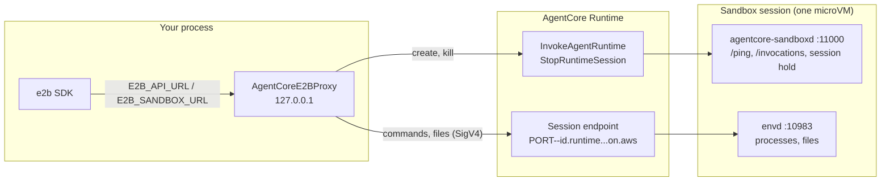

# E2B SDK on AgentCore Runtime

Run the unmodified [E2B SDK](https://github.com/e2b-dev/E2B) (Python or JS)
against sandboxes on Bedrock AgentCore Runtime. Each sandbox is an AgentCore
Runtime session of an image you deploy; commands, files, PTYs and directory
watches are served by E2B's own in-sandbox daemon, `envd`.

```python
from e2b import Sandbox
from agentcore_rl_toolkit.sandbox.e2b import AgentCoreE2BProxy

with AgentCoreE2BProxy() as proxy:
    with Sandbox.create(
        template="arn:aws:bedrock-agentcore:...:runtime/...",
        api_key=proxy.api_key,
        api_url=proxy.url,
        sandbox_url=proxy.url,
    ) as sbx:
        print(sbx.commands.run("uname -m").stdout)
```

## How it works



- **Control plane.** The proxy answers the E2B API itself. `Sandbox.create`
  starts a session with `InvokeAgentRuntime`, reads the session endpoint URL from
  the response, and initializes envd with a per-sandbox access token, the
  default user and the requested environment variables. Killing a sandbox, or
  reaching its timeout, calls `StopRuntimeSession`.
- **Data plane.** The SDK sends envd requests with `E2b-Sandbox-Id` and
  `E2b-Sandbox-Port` headers. The proxy maps E2B's envd port (49983) to the
  image's envd port, signs the request with SigV4, and streams it through that
  session's [session endpoint](https://docs.aws.amazon.com/bedrock-agentcore/latest/devguide/runtime-session-endpoints.html).
- **In the image.** `agentcore-sandboxd` serves AgentCore's contract on the
  serving port and keeps a started session busy between commands. envd runs
  beside it, unchanged from E2B's release.

The template is the runtime ARN. Build images with your usual pipeline; the
proxy does not implement E2B's template build API.

## 1. Build and push the image

Run from `examples/sandbox_e2b`:

```bash
../../sandboxd/build.sh --stage .
```

```bash
aws ecr get-login-password | docker login --username AWS --password-stdin <account>.dkr.ecr.<region>.amazonaws.com
```

```bash
docker buildx build --platform linux/arm64 -t <account>.dkr.ecr.<region>.amazonaws.com/<repository>:<tag> --push .
```

The [Dockerfile](Dockerfile) adds a release build of envd from E2B's artifact
bucket; its URL names the version. The proxy reports `envd_version` to the SDK,
which enables features by it, so pass the matching version when you change the
release. envd is part of
[e2b-dev/runtime](https://github.com/e2b-dev/runtime) (Apache-2.0). To add
sandboxes to your own image, copy its `ADD`, `COPY` and `CMD` lines; the E2B
SDK expects a `user` account with home `/home/user`.

## 2. Deploy

```bash
uv run --script deploy.py --name e2b_sandbox --image <image URI> --role-arn <execution role ARN>
```

`deploy.py` runs with its own boto3, which needs a release that supports
`allowedPorts` (1.43.123 or later); the toolkit's `[rollout]` extra pins an
older botocore through aiobotocore. It serves sandboxd on port 11000, adds envd's port 10983 to
`allowedPorts`, and prints the runtime ARN. The execution role needs to pull the
image and write logs. Deploying also needs `iam:PassRole` for that role.

Callers of the proxy need these permissions on the runtime and its `DEFAULT`
endpoint:

```json
{
    "Effect": "Allow",
    "Action": [
        "bedrock-agentcore:InvokeAgentRuntime",
        "bedrock-agentcore:InvokeAgentRuntimeProxy",
        "bedrock-agentcore:StopRuntimeSession"
    ],
    "Resource": [
        "arn:aws:bedrock-agentcore:<region>:<account>:runtime/<runtime id>",
        "arn:aws:bedrock-agentcore:<region>:<account>:runtime/<runtime id>/runtime-endpoint/DEFAULT"
    ]
}
```

## 3. Run

```bash
uv sync
AGENTCORE_E2B_RUNTIME_ARN=<runtime ARN> uv run python run_e2b.py
```

To point child processes, such as the JS SDK or another tool that uses E2B, at
the proxy, pass `proxy.environ` (`E2B_API_URL`, `E2B_SANDBOX_URL`, `E2B_API_KEY`)
in their environment.

## Differences from E2B

- **Templates.** `template` must be a runtime ARN. Pause and resume, fork,
  snapshots, metrics, network updates, volume mounts and MCP return HTTP 400.
- **Other ports.** `get_host()` returns an E2B host name that does not resolve.
  To reach a server in the sandbox, add its port to `allowedPorts` and send the
  request to `proxy.url` with `E2b-Sandbox-Id` and `E2b-Sandbox-Port` headers.
  The server receives it without an `Authorization` header.
- **State lives in the proxy.** `Sandbox.list()` shows this proxy's sandboxes,
  and their timeouts run in this process. `close()` stops the sessions that are
  still running. If the process dies first, sandboxd keeps each session busy
  until the runtime's `maxLifetime` (3600 seconds in `deploy.py`).
- **Long commands.** AgentCore ends a streaming connection after 60 minutes
  ([quotas](https://docs.aws.amazon.com/bedrock-agentcore/latest/devguide/bedrock-agentcore-limits.html)).
  The command keeps running; reattach with `sbx.commands.connect(pid)`. envd
  does not replay output written while no stream was attached.
- **Platform version.** envd currently cannot start commands on platform
  version V2, so `deploy.py` creates the runtime on V1.
- **Network.** Session endpoints accept public HTTPS only, so the proxy's host
  needs a route to `*.on.aws`.
- **One user per proxy.** Commands, PTYs and filesystem calls run as the
  proxy's `default_user` (E2B's `user`, in `/home/user`). The SDK names a
  per-call `user=` in the `Authorization` header, which SigV4 replaces, so a
  call that names another user fails; `files.read` and `files.write` pass it
  separately and honor it. For images without the `user` account, or to run as
  root, pass `AgentCoreE2BProxy(default_user="root", default_workdir=None)`.

The proxy listens on loopback. Control-plane requests need its random
`api_key` and envd requests need the sandbox's access token. Requests to other
allowed ports are forwarded for any local process that knows the sandbox ID.
