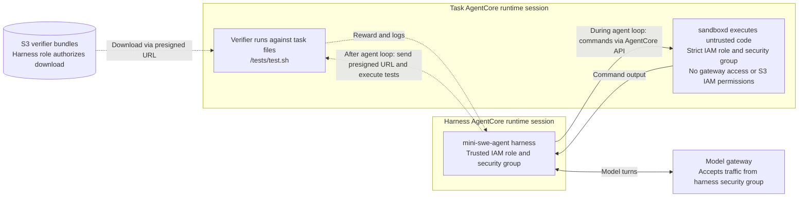

# Terminal agent on AgentCore

This example hosts [mini-swe-agent](https://github.com/SWE-agent/mini-swe-agent)
on AgentCore Runtime to solve and evaluate Harbor tasks
(e.g., [TMax](https://hub.harborframework.com/datasets/tmax/TMax-15K-Harbor/latest)).
The agent harness and the code it executes run in separate sessions, so task code does not
inherit the harness's access to the model gateway or verifier storage.

## Architecture

Each rollout uses two AgentCore Runtime sessions:

- **Trusted harness:** runs the agent loop, calls the model endpoint, and
  controls when grading begins. It holds the model credentials and S3
  permissions needed to deliver the verifier.
- **Task sandbox:** runs model-generated commands in the task's environment.
  It has its own IAM role and security group, with no model gateway access
  or S3 read IAM permissions.



The evaluation driver starts a rollout in the trusted harness session.
The harness starts a fresh task session and sends
the agent's bash commands to sandboxd through the Sandbox SDK. Command output
returns to the agent for the next model turn. Each command runs in a new
shell; task files persist across turns.

The task sandbox initially contains the task environment, while its verifier
stays in S3. After the agent loop ends, the harness issues a short-lived
presigned URL and instructs the sandbox to download and run the original
tests against the agent's work. The URL, tests, and grading feedback stay out
of the model conversation. The harness returns the reward and trajectory to
the evaluation driver, and both sessions are cleaned up.

Separating the sessions keeps infrastructure permissions outside untrusted
task code. Delaying verifier delivery also reduces opportunities for reward
hacking through access to tests or grading feedback during the agent loop.
The verifier still runs in the task sandbox, so this does not prevent
deliberate grader tampering.

## Run

Provide a model endpoint that supports OpenAI Chat Completions tool calls
and is reachable from the harness session. Fill in a copy of
[`config.example.toml`](config.example.toml) with an ECR repository using
immutable tags, a verifier bucket, VPC subnets, and separate execution roles
and security groups:

| Role | Required access |
|---|---|
| Both | Pull from this ECR repository; write their AgentCore logs |
| Harness | Invoke/stop this example's task runtimes; `GetObject` on `tmax/verifiers/*` |
| Task | No S3 read or runtime invocation IAM permissions |

On the model host's security group, allow traffic from the harness security
group only. For training gateways that choose their listening port dynamically,
allow TCP ports 0–65535 from that group. Keep the task security group separate
from the cluster's internal-traffic group. The subnets need routes to AgentCore
APIs, S3, and package repositories; the task security group needs no inbound
rules for commands sent through AgentCore.

Use a host with ARM64 Docker build support and Debian/Ubuntu-based task
images. Authenticate Docker to the ECR repository; the deploying identity
also needs `iam:PassRole` for both execution roles.

From the repository root, install the example and download the selected tasks:

```bash
uv sync --project examples/tmax_agent --group dev

uv run --no-project --python 3.12 --with harbor==0.23.0 \
  python examples/tmax_agent/download.py \
  --subset /path/to/tasks.json --output /path/to/task-data
```

Pass a task selection JSON via `--subset`. Its `tasks` entries specify
`package.org.name`, `package.name`, and `content_hash` to pin each Harbor
task version.

Build and deploy the harness and task environments, then evaluate against
your model endpoint:

```bash
cp examples/tmax_agent/config.example.toml /path/to/config.toml
# Fill in the account, roles, subnet and security group before continuing.

uv run --project examples/tmax_agent python examples/tmax_agent/prepare.py \
  --config /path/to/config.toml \
  --output examples/tmax_agent/manifest.json \
  /path/to/task-data/TASK_NAME

uv run --project examples/tmax_agent python examples/tmax_agent/deploy.py \
  --config /path/to/config.toml \
  --manifest examples/tmax_agent/manifest.json

uv run --project examples/tmax_agent python examples/tmax_agent/evaluate.py \
  --manifest examples/tmax_agent/manifest.json \
  --base-url http://MODEL_HOST:8000/v1 \
  --model-id YOUR_MODEL_ID \
  --output /path/to/results.json --concurrency 2
```

Pass one or more downloaded task directories to `prepare.py`.
Evaluation saves rewards, trajectories, and verifier output to `--output`.
