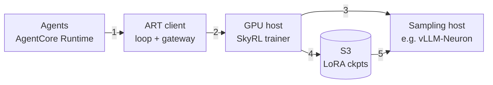

# SkyRL Tinker-compatible endpoint on EC2

ART's Tinker API training loop can use SkyRL as its endpoint in two ways:

| Mode | Training | Sampling | Setup |
|---|---|---|---|
| [Single-node GPU endpoint](#single-node-gpu-endpoint-skypilot) | Megatron on one GPU instance | vLLM on the same instance | SkyPilot launcher in this folder |
| [Hybrid training](#hybrid-training-gpu-trainer-with-separate-sampling-hardware) | FSDP LoRA on a GPU host | A separate server on other hardware, such as vLLM-Neuron on Trn2 | Already provisioned hosts, patched SkyRL |

Both use the same ART client, configuration and [training guide](../README.md); only the
endpoint differs.

## Single-node GPU endpoint (SkyPilot)

This example deploys **Qwen3.5-4B on one `p4d.24xlarge`** (8 A100 40 GB GPUs) with SkyPilot.
A separate CPU client uses the endpoint for LoRA training and sampling.
The supplied configuration uses Megatron with a 16,384-token context and one
active training client per endpoint.

Use these files as a starting point for your own single-node deployment:

- `endpoint.yaml`: set the model ID, SkyRL revision, and EC2 instance type.
- `backend_config.json`: set the training GPU count, inference replicas, parallelism,
  batch sizes, and context limits to match your model and hardware.

Adjust the two configs together and validate your chosen configuration.
Model downloads use Hugging Face `main` when setup runs; optionally set
`envs.MODEL_REVISION` to a tag or commit to keep a fixed model version.

### Prerequisites

- Linux, Python 3.12 via [uv](https://docs.astral.sh/uv/), Git, SSH, and rsync.
- AWS credentials with EC2 provisioning permissions and the IAM permissions below.
- Quota and available capacity for your instance type (P4d in this example).
- An existing private subnet with a unique `Name` tag in the region and outbound
  HTTPS access for packages and model weights.

The launcher needs SSH access (TCP 22) and endpoint access (`TINKER_PORT`, default
18080); the training client needs the endpoint port. Routing and firewalls must
permit these connections.
`--client-cidr` allows a source IPv4 range on both ports. For one host in the same
VPC, use its private IP plus `/32` (find it in EC2 details or `ip -4 addr`).
For separate hosts, use a suitable private subnet CIDR or a preconfigured security group.
A supplied security group must allow the client CIDR on both ports and all traffic within the group.

### Deploy

If IAM permissions are missing (for example with `PowerUserAccess`), first run
the command below with `--plan`. It makes no AWS changes and prints the path to
`deployer-iam-policy.json`. Have an administrator attach that JSON as a customer
managed policy, scoped to creating/reading `skypilot-v1`, binding its role and
instance profile, and passing the role to EC2. Then rerun without `--plan`.

From this directory, using your AWS profile:

```bash
export AWS_PROFILE=my-profile

uv run python deploy.py \
  --region us-west-2 \
  --cluster skyrl-tinker-endpoint \
  --subnet-id subnet-YOUR_PRIVATE_SUBNET \
  --client-cidr 10.0.1.10/32
```

The launcher prepares IAM and the security group, provisions EC2, installs SkyRL
and model weights, and waits for HTTP readiness. It prints the private endpoint
URL and SDK `base_model` path.

| Option | Purpose |
| --- | --- |
| `--region REGION` | Default `us-west-2`; must match the subnet. Use a new cluster name for another region. |
| `--reservation cr-...` | Use a matching capacity reservation in the subnet's AZ. |
| `--security-group-id sg-...` | Reuse a group with the required ingress; existing rules are checked without editing. |
| `--image-id ami-...` | Override the default DLAMI in the selected region. |
| `--state-dir PATH` | Override the local deployment-state directory. |

By default, the launcher resolves the regional AMI ID for AWS Deep Learning Base
OSS Nvidia Driver GPU AMI (Ubuntu 22.04), release **20260922**.

<details>
<summary>Custom AMI requirements</summary>

Provide Ubuntu 22.04 with user `ubuntu`, CUDA 13.0 at `/usr/local/cuda-13.0`,
an NVIDIA driver supporting CUDA 13 (580 or newer), and the instance-store mount
at `/opt/dlami/nvme`. Validate these assumptions when overriding the image.

</details>

Deployment state is saved under the temporary directory in `skyrl-endpoints/CLUSTER/`.
Keep it for repeat deployments, or use `--state-dir` to choose a persistent location.

### Connect

Use **`tinker==0.24.1`** in your client environment for this SkyRL version.
For the toolkit's training loop, follow the [training guide](../README.md)
using the `tinker_skyrl` extra, which includes rollout clients and the gateway.

```python
import tinker

service = tinker.ServiceClient(
    base_url="http://GPU_PRIVATE_IP:18080",
    api_key="tml-dummy",
)
trainer = service.create_lora_training_client(
    base_model="/home/ubuntu/skyrl/models/Qwen3.5-4B",
    rank=8,
)
```

`tml-dummy` is a placeholder: **the endpoint has no authentication or TLS; keep it
private**. HTTP readiness does not initialize GPU workers; the first training
client and sampler can take several minutes to initialize.

### Manage and resume

```bash
uv run sky queue skyrl-tinker-endpoint
uv run sky logs skyrl-tinker-endpoint
uv run sky stop skyrl-tinker-endpoint   # preserve EBS
# Deletes EC2 and root EBS. Back up checkpoints first.
uv run sky down skyrl-tinker-endpoint
```

| Remote path | Storage | Contents |
| --- | --- | --- |
| `/home/ubuntu/skyrl/` | Root EBS | Source, environment, model weights and reusable caches |
| `/home/ubuntu/skyrl-state/` | Root EBS | Metadata, checkpoints, adapters and logs |
| `/opt/dlami/nvme/skyrl/tmp/` | Instance store | Temporary files and Ray runtime scratch |

Repeat the deployment command to reuse a running endpoint or resume after `stop`.
Stop/start preserves EBS and clears instance store; continuing training requires
reconnecting and explicitly loading a saved checkpoint. To change the model or
backend config, stop the server job and use a new `--state-dir`. For changes to
the instance type, AMI, or network, use a new cluster name.

Failures leave resources in place. Check queue/logs; if an active job blocks a
retry, inspect it and explicitly cancel it with `uv run sky cancel CLUSTER JOB_ID`.
The endpoint stays running while idle, so stop it when finished. EBS and any
capacity reservation retain their own charges.

`down` deletes the root EBS data; backups are your responsibility. IAM resources
and security groups remain. Existing ingress rules are preserved during
deployment; remove obsolete client access explicitly.

## Hybrid training: GPU trainer with separate sampling hardware

SkyRL trains LoRA on a GPU host while a separate server samples on other hardware. The
ART client still points `endpoint` at SkyRL's API; SkyRL forwards each `sample()` to the
sampling server, which loads every new checkpoint from S3. Unlike the SkyPilot example,
this mode runs on hosts you have already provisioned and uses a different SkyRL revision.



Each step, the agents' model calls go through the ART client's rollout gateway, which
records token-level trajectories (1). The gateway samples through SkyRL, and the training
loop trains through it (2); SkyRL forwards each sample to the sampling server (3). After
each optimizer step, SkyRL exports the LoRA adapter to S3 (4), 41 MB in the
Qwen3.6-27B example. The next sample names the new checkpoint, so the sampling server loads it,
merges it into its base and refreshes its resident weights before replying (5).

| Step | Where | Guide |
|---|---|---|
| 1. Check out SkyRL `a6c07705` and apply [`patches/`](patches/) | GPU host | [SkyRL version and patches](serving/README.md#skyrl-version-and-patches) |
| 2. Grant S3 and AgentCore access and open the GPU host's route to the sampler | All hosts | [Network and permissions](serving/README.md#network-and-permissions) |
| 3. Start the trainer: [`serve.sh`](serve.sh) with `SKYRL_EXTERNAL_INFERENCE_URL` and a trainer-only FSDP `SKYRL_BACKEND_CONFIG` | GPU host | [Launch the trainer](serving/README.md#launch-the-trainer) |
| 4. Start the sampling server, for example [`serving/vllm_neuron/serve.sh`](serving/vllm_neuron/serve.sh) | Sampling host | [vLLM-Neuron sampling server](serving/vllm_neuron/README.md#launch-the-server) |
| 5. Run ART's training loop with `tinker>=0.25.0,<0.28.0` (tested: 0.27.2) and `"loss_weights": true` | Client host | [Training guide](../README.md) |

Setting `SKYRL_EXTERNAL_INFERENCE_URL` is what selects this mode in `serve.sh`; without it,
`serve.sh` launches the single-node configuration above. For a complete run, see the
[OfficeBench hybrid training example](../../../../../examples/trn_gpu_hybrid_training/README.md).
